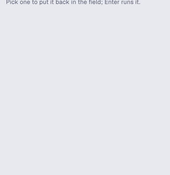

# Run Command for Orca

Run a one-off shell command from a sidebar panel in [Orca](https://github.com/stablyai/orca),
in a terminal of the workspace you are in, without leaving the chat. Type `secrets status` (or
`! secrets status`), press Enter, and it runs in that workspace's terminal tab.



> **This is a stopgap.** What I really want is Claude Code's `!` prefix in Orca's chat box: type
> `! <command>` in a chat and it runs. Chats that run inside a terminal tab already have it (the
> Claude TUI runs it), but the structured chat view sends `!pwd` to the model as a prompt. A
> plugin cannot add that, because Orca's plugin API has no hook on the chat composer. It needs
> Orca itself: [stablyai/orca#32165](https://github.com/stablyai/orca/issues/32165).

## What it does

- **One input line.** Type a command and press Enter (or **Run in terminal**). Enter is the
  confirmation: nothing runs before you press it. A leading `!` is dropped, so `! pwd` works too.
- **Pick the terminal.** It lists the workspace's terminal tabs that run a shell and remembers
  the one you used last. Tabs that run an agent are never offered, because typing into an agent
  sends it a prompt. On an Orca that lets plugins open terminals (host API 1.3 and later), it
  also offers **New terminal tab**, which runs the command in a fresh tab named after it.
- **Recent commands.** The last 10 commands, newest first. Pick one to put it back in the field;
  Enter runs it. **Clear** empties the list.
- **Palette commands:** `Run Command: Run the last command again` and
  `Run Command: Show recent commands`.

The output appears in the terminal tab, never in the panel or the chat.

## What it keeps, and what it asks for

It stores two things in the plugin's own storage: the recent commands and the id of the terminal
used last. **It never reads or stores a command's output**, and it makes no network calls.

| Capability | Why |
| --- | --- |
| `terminal:send` | Type the command into the terminal and press Enter (and open a new tab where Orca allows it). |
| `workspace:read` | List the focused workspace's terminal tabs. |
| `agent:read` | Leave out the tabs that run an agent. |
| `storage:own` | Keep the recent commands. |

It runs a small worker (the `trusted-worker` profile), because only a worker may type into a
terminal.

## Install

```sh
git clone https://github.com/RonanCodes/orca-run-command
orca plugin dev load ./orca-run-command   # prints what it would grant; re-run with --approve <fingerprint>
orca plugin open run-command              # shows the panel in the right sidebar
```

## Use

1. Open a terminal tab in the workspace (a plain shell, not an agent).
2. Open the **Run Command** panel in the right sidebar.
3. Type the command, for example `secrets status`, and press Enter.
4. Switch to the terminal tab to read the output.

## Known limits

- On Orca 1.4.246 a plugin can only type into a terminal that is already open, so the workspace
  needs one plain terminal tab first. A command typed into a terminal that is busy (a running
  program, an editor) goes to that program, as if you had typed it.
- The command runs as if typed in that terminal, in its current directory and shell.
- One line at a time: a pasted newline is refused, so a paste never runs extra commands.

## Develop

```sh
orca plugin types .      # writes .orca/types for tsc
npx tsc -p .             # type-check
orca plugin test .       # unit tests (src/*.test.ts) with orca/testing
orca plugin check .      # renders the panel in each src/panel.check.ts scenario
orca plugin dev watch .  # load into Orca, reload on save, stream logs
```

`src/commands.ts` holds the pure logic (reading a command, the history, picking a terminal),
`src/worker.ts` types into the terminal and keeps the history, `src/panel.tsx` is the panel, and
`src/protocol.ts` types the requests between them.

## License

MIT
